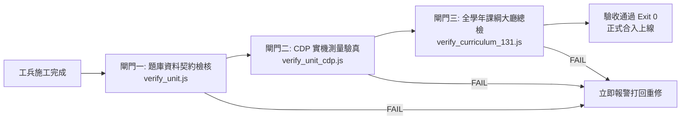

# 國小數學 APP 單元工廠化施工與全學年批次交付標準規約
> 文件代碼：`DOC-FACTORY-STD-v1.0`  
> 適用範圍：028-1 國小數學 APP 全學年（一年級至六年級，共 131 個課綱條目）  
> 核心宗旨：確立標準化派工、教具架構、SSOT 資料模型與機械化雙閘門，支撐從「單單元步進」躍升至「整年級批次交付驗收」。

---

## 零、架構定位與轉型目標

過去在一年級與三年級初期，專案採取「單單元極致細嚼（單步推進）」策略，主要目的在於**摸索與固定最佳工程模式**（防範視口抖動、iframe 穿透、題型死板罰寫、資料欄位分裂等歷史痛點）。

現已成功提煉出穩定的「日系擬物多模式教具 ＋ One-Screen 單屏緊湊 ＋ 多樣化真題矩陣 ＋ CDP 機械化雙閘門」套路。  
本手冊將施工與驗收流程**完全標準化、規格化**，使未來的開發能透過標準工單（Task Card）交由工兵批次施工，人類驗收則正式由「單題/單單元人工確認」升級為**「整年級自動化驗收 ＋ 抽樣盲審」**。

---

## 一、題庫真題規格：10 題多樣性防偷懶憲法

每一單元**嚴格且精確為 10 題**（不准偷工湊數，也絕不多做水題），題目來源必須為 `EXAM REAL/` 目錄中之實體國小段考試卷（臺北市內湖國小、高雄市永安國小、忠孝國小、陽明國小等）。

為徹底杜絕 AI 偷懶出現「10 題直式計算罰寫」或「同一情境換 10 次數字」，每單元 10 題必須覆蓋以下 **題型多樣性矩陣（10-Type Matrix）**：

| 題號 | 題型維度 | 核心考點與教學目標 | 示例情境 / 破招特色 |
| :---: | :--- | :--- | :--- |
| **Q01** | **規律探索 / 位值概念** | 觀察數的結構、位值跳躍、進退位或運算規律 | 如 $9\times7=63 \rightarrow 900\times7=6300$；跳數小火車 |
| **Q02** | **秒殺思維（免算比大小）** | 訓練數感與運算性質，不用動筆硬乘除即可秒答 | 乘數相同比被乘數；被除數相同除數越小商越大 |
| **Q03** | **生活估算 / 概數判斷** | 掌握四捨五入、概算取值、夠不夠買、裝得下嗎 | 如 $29\times5 \approx 30\times5 = 150$ |
| **Q04** | **除錯小偵探（迷思破招）** | 呈現國小學生常見計算或概念錯誤，要求指出錯誤處 | 個位進位十位忘記加；除法餘數大於除數 |
| **Q05** | **核心概念精選（含0或關鍵陷阱）** | 考核該運算的核心法典，特別是「含 0、跨位、特殊進退位」 | 中間含 0 的乘法 $309\times3$；除法商中間補 0 |
| **Q06** | **經典大滿貫 / 運算特質** | 運算整數特徵（如整千、整百湊整）或基本定義 | $125\times8=1000$；等分除與包含除的語意辨析 |
| **Q07** | **生活具象情境 A（包裝/容量/分裝）** | 超商、工廠、文具店、廚房分裝等真實生活情境 | 箱裝飲料進貨、烘焙餅乾分盒裝袋 |
| **Q08** | **生活具象情境 B（購物/找錢/分配）** | 校園園遊會、文具採買、獎品發放、平分糖果 | 獎品採買預算、平分給同學每人得幾件 |
| **Q09** | **幾何直觀 / 天平傾斜 / 數線** | 結合圖形、天平、條形圖或數線之視覺直觀題 | 算式天平左右傾斜比較、數線雷達標定落點 |
| **Q10** | **逆向推導 / 倍數 / 綜合思維** | 乘除互逆、加減互逆、已知結果反推原本數量 | 倒推原本有多少錢；綜合兩步驟思維挑戰 |

---

## 二、教具視覺與排版規範（One-Screen 單屏緊湊）

所有單元教具一律位於 `app/components/`，以獨立 HTML 頁面呈現，並透過 iframe 嵌入測驗大廳 `app/shell.js`。

### 1. 視覺設計語言（日系繪本擬物風）
- **色調**：採用柔和低飽和之日系暖色調（紙白 `#fcfbf9`、翡翠綠 `#059669`、珊瑚紅 `#e11d48`、琥珀橘 `#d97706`、靛青 `#4f46e5`、木質棕 `#854d0e`）。
- **質感**：純向量 SVG 搭配微投影（`box-shadow: 0 4px 12px rgba(0,0,0,0.06)`）與圓潤膠囊邊框（`border-radius: 12px~16px`）。
- **動態**：所有操作回饋（點擊、切換、分裝、飛入）均具備平滑 CSS transition（0.2s~0.3s ease-out），杜絕突兀跳閃。

### 2. 手機 One-Screen 單屏極致規範（防抖防溢出死律）
- **寬度規範**：
  - 視口寬度 360px ~ 390px 100% 入屏，**絕對禁止出現橫向水平捲軸**（`overflow-x: hidden`）。
  - 所有 SVG 必須具備自適應 `viewBox` 與 `width: 100%; height: auto;`。
- **高度規範（≤ 420px）**：
  - 教具在手機模式下，整體實體高度必須 **$\le 420\text{px}$**。
  - 外層測驗舞台（題幹 80px + 教具 420px + 選項 180px + 底欄 60px）總高度約 740px，在 844px 手機螢幕上一屏完全呈現，**零捲軸免滑動**。
- **防抖動核心契約（嚴禁 100vh）**：
  - 教具頁面的 `html, body` **絕對嚴禁**寫 `height: 100vh` 或 `min-height: 100%`！
  - 必須設定 `body { margin: 0; padding: 8px; height: auto; min-height: 0; box-sizing: border-box; }`。
  - 違反此條會導致外層 `shell.js` 的 `fitFrame` 偵測到高度無限遞增，造成手機端畫面上下瘋狂抖動。

### 3. 多模式教具架構（多題共用單一教具實驗台）
- 每個單元建議採用**「單一多模式通用實驗台」**（如 `multiplication_lab.html`、`division_lab.html`）。
- 透過 URL 參數（`?q=1` ~ `?q=10`）或題目資料中的 `visual_mode` 動態切換內部佈局與視覺元素，大幅降低載入成本與維護負擔。

---

## 三、題庫資料結構規範（SSOT 唯一真理來源）

路徑：`data/units/<Grade>/<UnitCode>.json`（例如 `data/units/G3/N-3-4.json`）

### 完整 JSON Schema 範例：
```json
{
  "code": "N-3-4",
  "title": "除法",
  "grade": 3,
  "question_count": 10,
  "verified_source": "臺北市內湖國小 114-1/113-1/112-1 期末 ＋ 高雄市永安國小 114-1 期末",
  "questions": [
    {
      "id": "G3-N-3-4-Q01",
      "exam_source": "臺北市內湖國小 112-1 期末",
      "section": "二、填填看",
      "question_num": 3,
      "title": "包含除分裝概念探索",
      "stem": "媽媽烤了 24 塊手工餅乾，每 6 塊裝成一袋，全部裝完可以裝成幾袋？",
      "choices": ["4 袋", "3 袋", "5 袋", "6 袋"],
      "answer_index": 0,
      "answer_raw": "4 袋",
      "visual_mode": "grouping",
      "final_check": "4",
      "component": "division-lab",
      "component_path": "components/division_lab.html?q=1",
      "fallback_height": 420,
      "explanation": {
        "concept": "包含除（以固定量為一單位進行分裝）",
        "steps": [
          "總共有 24 塊餅乾，每 6 塊裝一袋",
          "用乘法想：6 的幾倍是 24？6 × ( 4 ) = 24",
          "寫成除法算式：24 ÷ 6 = 4，所以可以裝成 4 袋"
        ],
        "trap": "容易把「每 6 塊裝一袋」誤看成「平分裝成 6 袋」，雖然答案數字接近，但算理意義不同。"
      }
    }
  ]
}
```

### 欄位硬性規定：
1. `stem`：題幹字句流暢乾淨，括號統一為半形 `( ? )` 或 `(  )`。
2. `choices`：陣列長度嚴格為 4，選項文字精簡對齊，包含 1 個正解與 3 個具教學價值的誘答選項。
3. `answer_index`：正解索引（0, 1, 2, 3），必須與 `choices[answer_index]` 和 `answer_raw` 完全一致。
4. `component_path`：必須指向實體存在的 `components/*.html`。
5. `explanation`：必須包含 `concept`（核心算理）、`steps`（3 步拆解）、`trap`（學生盲點破招）。

---

## 四、施工派工工法（OpenCode CLI 派工標準）

AGY 作為大腦架構師與驗收監工，恪守「WRITE-FILE LOCKED」原則，業務代碼一律透過 OpenCode CLI 派工落盤。

### 1. 唯一標準派工指令
```powershell
python tools/dispatch_worker.py --file task_card.md "執行工單施工"
```

### 2. 工單（Task Card）必備六要素
每次派工前產出的 `task_card.md` 必須包含：
1. **單元代碼與目標**（如 G3-N-3-4 除法）。
2. **題庫來源與 10 題規格清單**（明確指定 10 題之情境、數字、題幹、選項與正解）。
3. **教具組件視覺原型規格**（SVG 圖元、尺寸、CSS 類別、響應式規則）。
4. **輸出檔案清單**（`data/units/...`、`app/components/...`、`tools/verify_...`）。
5. **AC 驗收標準清單**（明確退出碼 Exit Code 0、高度 ≤ 420px、零控制台報錯）。
6. **防呆紅線提示**（禁止 100vh、禁止偷改 shell.js、禁止產生死圖）。

---

## 五、機械化雙閘門驗收體系（Automated Deterministic Gates）

每個單元（或整年級）完工時，必須通過以下三道機械化閘門，任何一項失敗（Exit Code ≠ 0）即視為未完成：



### 1. 閘門一：題庫契約與數學真值檢核（`tools/verify_<unit>.js`）
- 驗證單元題數恰為 10 題。
- 驗證每題皆有唯一 `stem`、4 個選項、有效 `answer_index`。
- 驗證 `component_path` 實體檔案存在。
- 依據數學真值邏輯驗算算式正解。

### 2. 閘門二：CDP 實機測量與單屏驗真（`tools/verify_<unit>_cdp.js`）
- 使用 Playwright/Puppeteer 實機啟動 Chrome，視口設定為手機標準 `390 × 844`。
- 逐一載入 10 題，檢查：
  - 教具高度是否嚴格滿足 $\le 420\text{px}$。
  - 視口是否有橫向溢出捲軸。
  - 瀏覽器控制台是否有任何 Error 或 Warning。
  - 點擊選項與切換題目是否流暢，無崩潰或卡死。

### 3. 閘門三：課綱 131 條目帳實閉環（`tools/verify_curriculum_131.js`）
- 驗證 `data/curriculum.json` 中對應單元的 `status` 變更為 `ready`。
- 驗證 `question_count` 登記為 10，`verified_source` 填寫真題出處。
- 驗證年級已開放比例正確累進，未開放者誠實保持 `upcoming`。

---

## 六、整年級批次交付運作流程（Grade-Level Batch Delivery Protocol）

當本單元（N-3-4）以本標準完成後，後續推進將升級為**「年級級別批次驗收」**模式：

1. **階段 1：整年級題庫藍圖排定（Grade Blueprint）**
   - 盤點該年級尚未完成之所有單元（如三年級剩餘 20 單元）。
   - 從 `EXAM REAL/` 實體試卷庫中批量採掘各單元之 10-Type 真題大綱，產出全學年題庫藍圖矩陣。
2. **階段 2：通用教具實驗台設計（Shared Lab Engines）**
   - 梳理該年級單元的教具需求，歸類為 3~5 款高擴展性通用實驗台（例如：幾何操作台、分數披薩量筒台、直式與算式天平台、統計圖表台）。
3. **階段 3：批次派工與流水線生成**
   - 透過派工指令分批發派工單至 OpenCode CLI，自動產出各單元之 JSON 與關聯教具模式。
4. **階段 4：年級全量自動化 CDP 驗收**
   - 執行該年級總驗收集成腳本（如 `tools/verify_grade3_all.js`），一鍵跑通全單元所有題目之資料結構、高度合規與控制台零錯誤。
5. **階段 5：人類抽樣盲審與上線發布**
   - 人類只需透過手機或展演台進行整年級隨機抽測與手感體驗，確認無誤後一次性切換該年級上線狀態。
