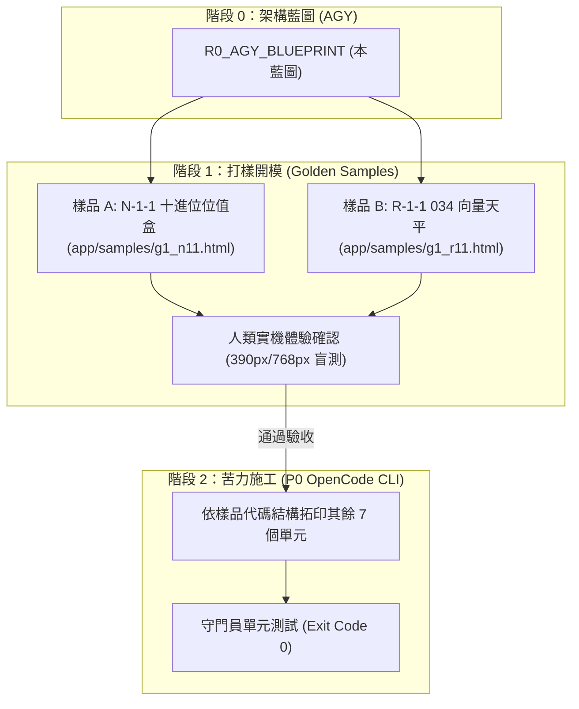

# R0_AGY_BLUEPRINT: 國小一年級 (G1) 9大單元視覺教具打樣與驗收規格藍圖

> **報告生成時間**：2026-11-05 20:36  
> **專案代號**：`028_1` (原 `028-1_國小數學APP`)  
> **流程階段**：AUTOFLOW 階段 0（架構藍圖與樣品規範）  
> **施工準則**：樣品驅動開發 (Sample-Driven Development, SDD) — 規格必有樣品，施工必有對照，驗收只認樣品吻合度。

---

## 🎯 一、 藍圖宗旨：為什麼必須先「打樣」？

在過去的教訓中，最嚴重的脫節在於：
1. **只有散文抽象描述**：企劃說要做「積木」，施工做成「80顆小黑點」，驗收時死無對證，只能遷就半成品。
2. **缺乏黃金樣品 (Golden Sample)**：沒有打樣 demo，施工單位無法進行像素與互動手感的 1:1 比對。
3. **本藍圖法定規範**：
   - 每一個單元在交給苦力（OpenCode）寫程式前，必須由藍圖給出**數值化規格**（尺寸、色碼、狀態機）。
   - 第一批先產出可互動的**單檔樣品 (Standalone Sample HTML)**，做為視覺驗收的「黃金模具 (Golden Standard)」。

---

## 🏛️ 二、 一年級 9 大法定條目樣品規格書 (條列數值化)

### 樣品 01: N-1-1【十進位位值盒與磁吸十條】
* **對接條目**：N-1-1 一百以內的數（位值、化聚、十進位結構）
* **展示情境（打樣 Demo）**：計算 $60 + 20$ 與 9 顆湊滿 10 顆聚合。
* **視覺參數與佈局**：
  * **畫布尺寸**：寬 360px × 高 280px (自適應 100%)。
  * **雙艙結構**：
    * 左側【十位艙】：寬度佔比 55%，底色 `#FFF7ED`，邊框 2px 虛線 `#F97316`。
    * 右側【個位艙】：寬度佔比 45%，底色 `#F8FAFC`，邊框 2px 虛線 `#94A3B8`。
  * **積木實體尺寸**：
    * 個位小白積木：$28 \times 28 \text{ px}$，圓角 4px，漸層白 `#FFFFFF` 到 `#E2E8F0`，深色描邊 `#64748B`。
    * 十位橘色十條：$28 \times 160 \text{ px}$，由 10 個連體方格構成，主色 `#FB923C`，每格帶淺色內凹刻度線。
* **狀態機行為 (State Machine)**：
  1. `EMPTY_OR_PARTIAL`: 個位艙容納 0~9 顆小白方塊，支援拖曳吸附網格。
  2. `FUSION_TRIGGER`: 當放入第 10 顆時，個位艙所有方塊觸發 300ms 震動光暈 (`#F59E0B`)。
  3. `MERGED_TO_TEN`: 10 顆方塊自動吸附熔接成一根垂直「橘色十條」，平滑滑移至左側十位艙。
  4. `COMPUTE_DISPLAY`: 底部即時顯示算理看板：「6 個十 ＋ 2 個十 ＝ 8 個十 (80)」。
* **驗收標準 (Acceptance Criteria)**：
  - [ ] 螢幕上絕對不得出現超過 10 顆獨立個位方塊。
  - [ ] 合併過程動畫幀率達 60fps，無卡頓。
  - [ ] 支援手機單手觸控，觸控熱區 $\ge 44 \text{ px}$。

---

### 樣品 02: N-1-2【雙軌對齊滑動條與差值探照燈】
* **對接條目**：N-1-2 加法和減法（比較型減法原型）
* **展示情境（打樣 Demo）**：$8$ 顆蘋果比 $5$ 顆蘋果多幾顆？
* **視覺參數與佈局**：
  * **雙軌載體**：上下雙平行滑軌，間距 24px。
  * **物件實體**：圓形計數圓片，直徑 32px，上軌紅色 `#EF4444`，下軌藍色 `#3B82F6`。
* **狀態機行為**：
  1. `ALIGNED_PAIR`: 前 5 顆圓片自動建立一對一垂直綠色虛線連動。
  2. `DIFFERENCE_HIGHLIGHT`: 超出的 3 顆圓片被金色流光矩形框選，標註文字「相差 3 顆」。
  3. `FORMULA_SYNC`: 下方同步顯現算式：`8 - 5 = 3`（凸出的部分即為減法差值）。
* **驗收標準**：
  - [ ] 拖動上下滑塊時，垂直對齊虛線自適應動態繪製。
  - [ ] 直觀呈現「一對一消除」概念，徹底杜絕死背加減。

---

### 樣品 03: N-1-3【雙排十格陣 (Ten-Frame) 與彈弓補位】
* **對接條目**：N-1-3 基本加減法（湊十法與拆十法心算）
* **展示情境（打樣 Demo）**：$9 + 4 = 13$ 湊十動態。
* **視覺參數與佈局**：
  * **載體**：兩個 $2 \times 5$ 的標準十格蛋盒，圓角 8px，邊框 2px `#CBD5E1`。
  * **單格尺寸**：$36 \times 36 \text{ px}$。
* **狀態機行為**：
  1. `SETUP`: 左盒已填滿 9 格（留 1 缺口），右盒已填 4 格。
  2. `TAP_TO_FILL`: 點擊右盒任一圓點，該點化為光球，沿拋物線飛入左盒填滿第 10 格。
  3. `TEN_LOCKED`: 左盒亮起「滿十閉鎖」金色光框，數字顯示 `10`；右盒剩下 `3`。
  4. `SUMMARY`: 畫面展開分解樹：$4$ 分解為 $1$ 與 $3$，$9+1=10$，$10+3=13$。
* **驗收標準**：
  - [ ] 拋物線補位動畫時長在 250ms~350ms 之間，反饋乾脆俐落。
  - [ ] 分解樹分支線與十格陣動態完全同步。

---

### 樣品 04: N-1-4【毛玻璃遮罩數線反推】
* **對接條目**：N-1-4 解題（括號在不同位置之未知數加減應用）
* **展示情境（打樣 Demo）**：$(\quad) + 5 = 12$
* **視覺參數與佈局**：
  * **數線主軸**：0 到 20 刻度數線，每 5 刻度加粗標記。
  * **遮罩體**：毛玻璃質感方框 (`backdrop-filter: blur(8px)`)，中間帶有金屬質感問號標籤。
* **狀態機行為**：
  1. `MASKED`: 起點被遮罩盒覆蓋，只見箭頭向右跨越 5 格到達刻度 12。
  2. `DRAG_REVERSE`: 引導手勢拖曳遮罩盒沿數線反向倒退 5 格回到刻度 7。
  3. `REVEAL`: 遮罩盒透明度漸變為 0，顯露底層刻度 7，算式聯動：`12 - 5 = 7`。
* **驗收標準**：
  - [ ] 數線具備步進磁吸（Snap to ticks），拖動精準咬合。

---

### 樣品 05: N-1-5【碰壁基準牆與迴紋針卡尺鏈】
* **對接條目**：N-1-5 長度（長度直接比較、間接比較與個別單位）
* **展示情境（打樣 Demo）**：量測鉛筆長度等於幾根迴紋針。
* **視覺參數與佈局**：
  * **基準紅線**：左側 $X=20\text{px}$ 垂直基準碰壁線，鮮紅色 `#EF4444`。
  * **被測物**：等角木紋鉛筆（長度 180px）。
  * **個別單位**：銀色金屬迴紋針（標準長度 45px）。
* **狀態機行為**：
  1. `WALL_ALIGN`: 拖曳鉛筆靠近紅線，自動磁吸貼平基準線。
  2. `CHAIN_SNAP`: 拖出迴紋針，首枚自動對齊基準線，後續迴紋針自動頭尾相扣成鏈。
  3. `READOUT`: 當迴紋針排滿鉛筆長度時，上方浮出括號標籤「剛好 4 根迴紋針長」。
* **驗收標準**：
  - [ ] 嚴禁出現物件未對齊基準線即可讀取數值的錯誤狀態。

---

### 樣品 06: S-1-1【034 Anatomy 等角形體旋轉投影儀】
* **對接條目**：S-1-1 形體之辨認（破除形體方位偏見、立體與平面辨認）
* **展示情境（打樣 Demo）**：360度旋轉正方形、立體圓柱拓印圓形。
* **技術重用**：直接載入 `034_anatomy_interactive_svg/core/isometric.js` 投影矩陣。
* **視覺參數與佈局**：
  * **渲染畫布**：SVG 視口 $320 \times 240$，四階光影面板（Top/Left/Right/Stroke）。
  * **旋轉控制器**：底部弧形角度滑桿（0° ~ 360°）。
* **狀態機行為**：
  1. `ROTATING`: 滑動滑桿，正方形於平面上旋轉，角標（4個直角）與等長邊（4邊）即時動態標註，向孩子證明「轉了方向依然是正方形」。
  2. `UNFOLD_ROLL`: 圓柱體在紙面上滾動一週，側表面展開為長方形，上下兩底拓印為圓形。
* **驗收標準**：
  - [ ] 純 SVG 向量渲染，代碼體積 $< 15\text{ KB}$，無任何 WebGL/Three.js 依賴。

---

### 樣品 07: S-1-2【034 物理重力積木台】
* **對接條目**：S-1-2 形體之操作（堆疊、滾動、滑動）
* **展示情境（打樣 Demo）**：球體滑落 vs 方塊穩固堆疊。
* **視覺參數與佈局**：
  * 034 等角桌面（俯角 30°）。
* **狀態機行為**：
  1. `STACK_STABLE`: 將立方體放置於立方體上方，兩平面接觸，發出清脆吸附音效，穩定堆高。
  2. `ROLL_COLLAPSE`: 將球體疊放於球體或傾斜面時，球體沿等角向量軸向下滑動滾出畫布，並跳出微提示「球只有彎曲面，無法堆疊」。
* **驗收標準**：
  - [ ] 接觸面判斷邏輯準確，符合真實物理直覺。

---

### 樣品 08: R-1-1【034 幾何向量平衡天平 (Lever Balance)】
* **對接條目**：R-1-1 算式與符號（等號「=」為天平兩側平衡狀態）
* **展示情境（打樣 Demo）**：$5 = 2 + 3$ 天平配平。
* **技術重用**：`034_anatomy_interactive_svg/components/lever_balance.html`。
* **視覺參數與佈局**：
  * 中央支點、等臂槓桿、左右懸掛托盤、指針角度刻度。
* **狀態機行為**：
  1. `UNBALANCED`: 左盤 5 顆重物，右盤 2 顆重物；槓桿傾斜 -15°，中央等號處顯示紅色不平衡記號。
  2. `BALANCING`: 右盤投入 3 顆重物，力矩計算達到平準，槓桿以平滑彈簧阻尼振盪歸零。
  3. `EQUALS_ACHIEVED`: 指針回正，中央亮起金色大型「$=$」符號，底部輸出雙向成立算式：`5 = 2 + 3` 且 `2 + 3 = 5`。
* **驗收標準**：
  - [ ] 槓桿具備真實力矩物理動態公式（$\sum m \cdot d$），動態阻尼自然。

---

### 樣品 09: D-1-1【分類抽屜與正字劃記計數器】
* **對接條目**：D-1-1 資料分類與呈現（依單一特徵分類與簡易統計表格）
* **展示情境（打樣 Demo）**：將散落的幾何圖形分類收納並自動畫「正」字。
* **視覺參數與佈局**：
  * 上半部：亂序散落的圖形區（圓形、三角形、正方形）。
  * 下半部：3 個標籤抽屜，右側附帶簡易計數表。
* **狀態機行為**：
  1. `SORT_DROP`: 孩子將圖形拖曳丟入對應標籤抽屜，抽屜自帶彈性吸入效果。
  2. `TALLY_DRAW`: 每放入一個，統計表對應行自動以毛筆質感繪製一劃「正」字筆劃。
  3. `CONVERT_BAR`: 點擊「查看統計」，「正」字自動展開為整齊立正的直條圖形柱。
* **驗收標準**：
  - [ ] 拖放目標感應容差半徑 $\ge 30\text{px}$，避免小童操作挫折。

---

## 🛠️ 三、 AUTOFLOW 執行階段劃分與打樣計畫

為貫徹「先打樣，再施工」標準，本計畫嚴格區分打樣期與施工期：

### 首批打樣交付物 (Golden Samples)
1. **樣品 A (`app/samples/g1_n11_base10.html`)**：
   - 解決最核心的「積木太醜、太小、100以內怎麼算」問題。
   - 實作「十進位位值盒」＋「小白方塊磁吸聚合十條」。
2. **樣品 B (`app/samples/g1_r11_balance.html`)**：
   - 解決「等號不是算答案，而是兩端平衡」的算理核心。
   - 直接移植 034 專案的向量天平。

---

## 📋 四、 人類驗收確認要點

1. **規格是否足夠具體？**（數值、狀態機、邊界條件已全部條列定錨，不再有模糊散文）。
2. **是否先由我產出這兩份極簡獨立的打樣 HTML（樣品 A 與樣品 B）供你實機把玩？**
   - 體驗手指觸控、拖曳手感、視覺質感。
   - 滿意後，才把這套模具規格簽發給 P0 OpenCode 去批量施工。
