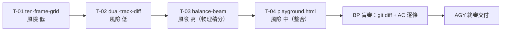

# R1_BP_EXECUTION_PLAN: 首批三大核心教具元件原子任務卡與施工計畫

## 📌 文件屬性表頭 (Document Attributes Header)
1. **任務編號**：20261105_2035_g1_visual_spec
2. **對應藍圖**：R0_AGY_BLUEPRINT.md
3. **文件性質**：階段 1：BP 細部施做計畫與清單
4. **編寫角色**：BP (Big Pickle)
5. **鋼印狀態**：<!-- AUTOFLOW_VERIFIED_SIGNATURE: BP_STAGE1_PLAN_20261106 -->

> **BP 職責聲明**：本文件僅拆卡與定錨驗收數值，**不寫業務代碼**。代碼 100% 由通道 1 本地 OpenCode CLI (GLM) 帶手腳落地，落盤後由 BP 以 `git diff` 逐行盲審比對 R0 數值。

---

## 一、工程架構與設計準則

### 1.1 技術選型（BP 定案，施工不得自行變更）

| 項目 | 定案 | 理由（否決替代方案） |
| :--- | :--- | :--- |
| 元件型態 | 原生 **Web Components**（`customElements.define` + Shadow DOM） | 樣品 Showcase 為 973 行單檔全域函式縫合體，`renderTenFrame` 等全域函式互相污染；Shadow DOM 提供樣式硬隔離 |
| 載入方式 | **傳統 `<script>` 全域 IIFE，禁 `type="module"`** | `file://` 直開時 ES Module 受 CORS 封鎖，違反「純離線秒開」鐵律五 |
| 繪圖 | 純 **SVG**（`createElementNS`），禁 Canvas 2D 貼圖、禁 WebGL、禁 Three.js | R0 樣品 06 明確要求 `< 15KB` 向量體積 |
| 依賴 | **零外部依賴**：無 CDN、無 npm、無打包器、無外部字型 | 鐵律五：純靜態離線 |
| 樣式 | CSS 自訂屬性 (`--tfg-*`, `--dtd-*`, `--bb-*`) 對外開放主題化 | Shadow DOM 內 `var()` 可穿透，供 T-04 面板實時調參 |
| 單位 | 一律 `px` 絕對數值（不用 `rem`） | 三端視覺驗收需 1:1 對照 R0 數值 |
| 無障礙 | 每個可互動元素 `role` + `aria-label`，支援 `prefers-reduced-motion` | 小一學童＋教師投影使用 |

### 1.2 檔案契約

```text
app/
├── components/
│   ├── ten-frame-grid.js     # T-01  <ten-frame-grid>
│   ├── dual-track-diff.js    # T-02  <dual-track-diff>
│   └── balance-beam.js       # T-03  <balance-beam>
└── playground.html           # T-04  調試台（以傳統 script 依序載入上面三檔）
```

### 1.3 全域硬約束（四張卡共通）

- 每檔獨立可執行：單獨 `<script src>` 載入即完成 `customElements.define`，無全域變數洩漏（IIFE 包裹）。
- 每檔 ≤ 300 行、≤ 12KB（未壓縮）；三檔合計 ≤ 30KB。
- 每個元件 `disconnectedCallback` 必須清除 `requestAnimationFrame` / `setTimeout` / `ResizeObserver`，**零計時器洩漏**。
- 所有數值變更走 `attributeChangedCallback`，不得直接改 DOM 內部狀態當唯一真相（SSOT：attribute 為唯一輸入源）。

---

## 二、任務卡詳細拆解

### 🎫 T-01：`<ten-frame-grid>` 十格陣與滿十閉鎖

| 欄位 | 內容 |
| :--- | :--- |
| **目標路徑** | `app/components/ten-frame-grid.js` |
| **對接條目** | N-1-3 基本加減法（湊十法 / 拆十法） |
| **負責工兵** | 通道 1 OpenCode CLI (GLM)，`stdin=DEVNULL` + `shell=True` |
| **依賴** | 無（首張卡，可立即開工） |
| **預估** | 1 輪施工 + 1 輪修正 |

**視覺數值（逐項鎖死，取自 R0 樣品 03）**

| 項目 | 數值 |
| :--- | :--- |
| 格子尺寸 | `36 × 36 px`（樣品僅 26px，本卡放大至觸控合格） |
| 格距 gap | `4 px` |
| 陣列 | `grid-template-columns: repeat(5, 36px)` / `rows: repeat(2, 36px)` |
| 容器 | `padding 6px`、`border-radius 8px`、`border 2px solid #CBD5E1`、底 `#F8FAFC` |
| 圓點 | 直徑 `24 px`，`radial-gradient(circle at 30% 30%, #F87171, #DC2626)`；藍版 `#60A5FA → #2563EB` |
| 空格外框 | `1px dashed #CBD5E1`、`radius 4px` |
| 滿十光框 | `#FACC15`、`2.5px`、外光暈 `0 0 12px rgba(250,204,21,.8)` |
| 觸控熱區 | 每格可點範圍 `≥ 44 × 44 px`（以透明 padding 擴張，視覺仍 36px） |

**狀態機（四態，嚴格單向不可跳階）**

1. `EMPTY_OR_PARTIAL`：`0 ≤ value ≤ 9`。點擊空格 → `value+1`，圓點 `scale(0→1)` 160ms `ease-out`。
2. `FUSION_TRIGGER`：`value` 由 9 → 10 瞬間，全 10 顆圓點震動光暈 **300ms ± 30ms**（`#F59E0B`），同時禁止再輸入。
3. `FULL_LOCKED`：光暈結束後鎖框 `#FACC15`，角標顯示 `10`，再點擊觸發 `overflow` 事件且**不得新增第 11 顆**。
4. `RESET`：外部設 `value < 10` 或呼叫 `reset()`，動畫 120ms 淡出，回 `EMPTY_OR_PARTIAL`。

**輸入屬性 (Attributes)**

| 屬性 | 型別 | 預設 | 說明 |
| :--- | :--- | :--- | :--- |
| `value` | int `0..10` | `0` | 已填格數；越界自動夾至合法值並派 `overflow` |
| `fill-color` | string | `#DC2626` | 圓點主色（藍版傳 `#2563EB`） |
| `interactive` | boolean | `true` | `false` 時唯讀（用於展示雙盒對照） |
| `locked` | boolean | `false` | 外部強制鎖定（湊十完成後由父層鎖左盒） |
| `label` | string | `''` | `aria-label` 前綴，如「左盒」 |

**對外事件 (CustomEvent，皆 `bubbles:true, composed:true`)**

| 事件名 | `detail` | 時機 |
| :--- | :--- | :--- |
| `ten-frame:fill` | `{value, previous, index}` | 每次填格成功 |
| `ten-frame:full` | `{value:10}` | 進入 `FULL_LOCKED` |
| `ten-frame:overflow` | `{value:10, attempted:11}` | 已滿仍被點擊（不得靜默吞掉） |
| `ten-frame:reset` | `{previous}` | 歸零 |

**驗收標準 (AC，可機械檢驗)**

- [ ] AC-01-1：DOM 內 `.dot` 節點數 **恆 ≤ 10**；連續點擊 25 次後仍為 10，且 `overflow` 事件計數 = 15。
- [ ] AC-01-2：`value=9` 時派 `fill`，`fill → full` 事件間隔落在 `270ms ~ 330ms`。
- [ ] AC-01-3：`value=10` 時計算樣式 `border-color` = `rgb(250, 204, 21)`。
- [ ] AC-01-4：390px 視窗下，單格 `getBoundingClientRect()` 點擊熱區 ≥ `44 × 44`。
- [ ] AC-01-5：`disconnectedCallback` 後 500ms 內無任何 console 輸出（證明計時器已清）。

---

### 🎫 T-02：`<dual-track-diff>` 雙軌差值探照燈

| 欄位 | 內容 |
| :--- | :--- |
| **目標路徑** | `app/components/dual-track-diff.js` |
| **對接條目** | N-1-2 比較型減法（一對一對應） |
| **負責工兵** | 通道 1 OpenCode CLI (GLM) |
| **依賴** | 無硬依賴，但**排程在 T-01 之後**（複用其 SVG 圓片繪製與 44px 熱區寫法） |
| **預估** | 1 輪施工 + 1 輪修正 |

**視覺數值（取自 R0 樣品 02 + Showcase 實測座標）**

| 項目 | 數值 |
| :--- | :--- |
| 畫布 | `viewBox="0 0 320 200"`，`width:100%`，背景透明（由父層給底） |
| 上軌 y | `60`，下軌 y | `110` |
| 軌間距 | `24 px`（圓片邊到邊） |
| 圓片 | `r = 12`（直徑 24，R0 標 32 → 以 `r=16` 為上限，390px 下自動降為 `r=12`） |
| 上軌色 | `#EF4444`，下軌色 `#3B82F6` |
| 對齊虛線 | `stroke #4ADE80`、`stroke-width 2`、`stroke-dasharray "3,3"`、y 由 `65 → 95` |
| 差值金框 | `stroke #FACC15`、`2.5`、`rx 6`、`x` 起點 = 第 `b` 顆圓心 `-16`、寬 = `diff × step`、高 `40`、y `30` |
| 差值標籤 | 12px 粗體 `#FACC15`，文字「多出 N 顆 (差值)」，`y=20` 置中 |
| 算式列 | 16px 粗體 `#F8FAFC`，`y=170` 置中，格式 `A － B ＝ D` |

**狀態機**

1. `ALIGNED_PAIR`：`min(top,bottom)` 顆建立垂直綠虛線一對一連動。
2. `DIFFERENCE_HIGHLIGHT`：`diff = top - bottom > 0` 時金框流光框選超出段（流光 `stroke-dashoffset` 每 20ms 位移，`prefers-reduced-motion` 時停用）。
3. `FORMULA_SYNC`：算式與框選同幀更新（同一次 rAF 內完成，禁兩段式重繪）。
4. `EQUAL_EDGE`（R0 未載明，BP 補定邊界）：`diff = 0` 時**不出金框**，改顯示「一樣多」綠字 `#4ADE80`，算式顯示 `A ＝ B`。

**輸入屬性**

| 屬性 | 型別 | 預設 | 說明 |
| :--- | :--- | :--- | :--- |
| `top-count` | int `0..10` | `8` | 上軌顆數 |
| `bottom-count` | int `0..10` | `5` | 下軌顆數 |
| `top-color` / `bottom-color` | string | `#EF4444` / `#3B82F6` | 圓片色 |
| `show-formula` | boolean | `true` | 是否顯示底部算式 |
| `animate` | boolean | `true` | 金框流光開關 |

**對外事件**

| 事件名 | `detail` | 時機 |
| :--- | :--- | :--- |
| `diff:change` | `{top, bottom, diff, formula}` | 任一 count 變更並重繪完成 |
| `diff:invalid` | `{attr, attempted, max:10}` | 傳入 > 10 或負數（夾值後仍派事件） |

**驗收標準**

- [ ] AC-02-1：`top=8, bottom=5` → 金框 `getBBox().width` = `3 × step`（`step` 由實際圓心間距量測，誤差 ≤ 1px）。
- [ ] AC-02-2：`top=5, bottom=5` → 無金框節點、存在「一樣多」文字、算式為 `5 ＝ 5`。
- [ ] AC-02-3：`top=11` → 夾為 10 並派 `diff:invalid`，畫面不破版（無 SVG 元素超出 `viewBox`）。
- [ ] AC-02-4：綠虛線數量恆 = `min(top, bottom)`。
- [ ] AC-02-5：`prefers-reduced-motion: reduce` 下無任何 `stroke-dashoffset` 變動。

---

### 🎫 T-03：`<balance-beam>` 幾何向量等號天平

| 欄位 | 內容 |
| :--- | :--- |
| **目標路徑** | `app/components/balance-beam.js` |
| **對接條目** | R-1-1 算式與符號（等號 = 兩端平衡） |
| **負責工兵** | 通道 1 OpenCode CLI (GLM) |
| **依賴** | T-01、T-02 完成後開工（唯一含物理積分迴圈的卡，風險最高，排最後攻堅） |
| **預估** | 2 輪施工 + 1 輪物理調參 |

> ⚠️ **BP 盲審基線差異（必查）**：Showcase 樣品 08 的 `setBalance()` 僅用 `isBalanced ? 0 : ±12°` 靜態傾角，**沒有力矩計算、沒有阻尼振盪**，不符合 R0「真實力矩公式 Σm·d + 動態阻尼」。T-03 必須補上真物理，不得照抄樣品。

**視覺數值**

| 項目 | 數值 |
| :--- | :--- |
| 畫布 | `viewBox="0 0 340 200"` |
| 支點 | 三角形 `170,90 150,160 190,160`，填 `#475569` |
| 槓桿 | `rect x=50 y=86 w=240 h=8 rx=3`，填 `#94A3B8`，繞 `(170,90)` 旋轉 |
| 吊臂長 | 左 `x=70`、右 `x=270`（等臂，`d = 100px`） |
| 吊盤 | `rect w=50 h=6 rx=2`，填 `#CBD5E1`，掛線 `#64748B` `1.5px` |
| 盤上砝碼 | 圓片 `r=7`，左 `#FB923C`、右 `#38BDF8`，單排最多 10，第 6 顆起自動折第二排 |
| 傾角上限 | `±15°`（硬夾） |
| 平衡大「＝」 | 金色 `#FACC15`、`font-size 34`、`font-weight 900`，`scale(0.6→1)` 320ms |
| 指針 | 支點上方 `24px` 弧尺，刻度 `-15° / 0° / +15°` |

**物理模型（BP 指定公式，施工不得自創）**

```text
力矩差  Δτ = (leftWeight × d) - (rightWeight × d)
目標角  θ_target = clamp(atan2(Δτ, k_arm) , -15°, +15°)     // k_arm = 1200
積分    θ'' = stiffness × (θ_target - θ) - damping × θ'
        stiffness = 0.012, damping = 0.18, dt 由 rAF 實測夾在 [8ms, 34ms]
收斂判定 |θ_target - θ| < 0.1° 且 |θ'| < 0.5°/frame  → 進入 EQUALS_ACHIEVED
```

**狀態機**

1. `UNBALANCED`：`Δτ ≠ 0`，槓桿傾斜至 `θ_target`，中央顯示紅色 `≠` 記號。
2. `BALANCING`：`Δτ` 歸零，彈簧阻尼振盪歸零，`±15°` 內不得甩出。
3. `EQUALS_ACHIEVED`：收斂後中央亮金「＝」，底部同時輸出雙向算式 `5 ＝ 2 ＋ 3` 與 `2 ＋ 3 ＝ 5`。

**輸入屬性**

| 屬性 | 型別 | 預設 | 說明 |
| :--- | :--- | :--- | :--- |
| `left-weight` | number `0..10` | `5` | 左盤砝碼數（質量，單位 1） |
| `right-weight` | number `0..10` | `2` | 右盤砝碼數 |
| `right-expression` | string | `''` | 右盤分解字串，如 `2+3`；空值時自動以總數顯示 |
| `damping` | number | `0.18` | 供 T-04 面板調參（0.05 抖不停 / 0.6 幾乎瞬停） |
| `animate` | boolean | `true` | `false` 直接跳 `θ_target`（給截圖與 reduced-motion 用） |

**對外事件**

| 事件名 | `detail` | 時機 |
| :--- | :--- | :--- |
| `balance:change` | `{left, right, theta, torqueDelta, balanced}` | 每 rAF 幀最多派 1 次（節流 16ms） |
| `balance:balanced` | `{left, right, formula, formulaReverse}` | 首次收斂進 `EQUALS_ACHIEVED` |
| `balance:clamped` | `{requested, clamped:15}` | 角度或質量被硬夾（不得靜默） |

**驗收標準**

- [ ] AC-03-1：`left=5, right=2` → 穩定後 `|θ|` 落在 `8° ~ 15°`，且傾向左側下沉（`θ < 0`）。
- [ ] AC-03-2：`left=5, right=5` → `1.2s` 內 `|θ| < 0.1°`，並派 `balance:balanced` 恰好 1 次（不得重複派發）。
- [ ] AC-03-3：連續 3 次抖動輸入（5→6→5→6），`θ` 全程不超過 `±15°`，無 NaN。
- [ ] AC-03-4：`right=5, right-expression="2+3"` → 底部兩條算式同時出現且皆成立。
- [ ] AC-03-5：`damping=0.05` 時仍於 5s 內收斂（不發散）。
- [ ] AC-03-6：`disconnectedCallback` 後 rAF 迴圈停止（以 `performance.now()` 取樣 500ms 內無新 `balance:change`）。

---

### 🎫 T-04：`app/playground.html` 三端調試台

| 欄位 | 內容 |
| :--- | :--- |
| **目標路徑** | `app/playground.html`（單檔，內嵌 `<style>` 與 `<script>`） |
| **對接條目** | 全三元件（不屬單一課綱條目，屬驗收基礎設施） |
| **負責工兵** | 通道 1 OpenCode CLI (GLM) |
| **依賴** | T-01、T-02、T-03 全部完成（依序 `<script src>` 載入） |
| **預估** | 1 輪施工 + 1 輪修正 |

**版面規格**

| 區塊 | 內容 |
| :--- | :--- |
| 頂部工具列 | 寬度切換三鈕：`390 手機` / `768 平板` / `960 電腦`；當前寬度數字顯示 |
| 舞台 `.stage` | `margin-inline:auto`、`transition: max-width 200ms`、預設 `max-width:960px`、`outline 1px dashed #CBD5E1` |
| 三元件區 | 每元件一張卡：`<h2>` 元件名 + 實例 + 參數面板（`input[type=range]` / `number`）即時綁 attribute |
| 事件日誌 | 底部固定高 `160px`、`overflow-y:auto`、等寬字 `11px`，保留**最近 20 筆**，格式 `[HH:MM:SS.mmm] event-name {"k":v}` |
| 一鍵情境 | 三顆按鈕：`湊十 9+4`、`比較 8 vs 5`、`天平 5 = 2+3`（串接三元件演出） |
| 重置 | 全元件 `reset()` + 清空事件日誌 |

**三端驗收切換機制（BP 定案）**

> 不得只靠 `@media`（桌機縮窗無法測 390px）。採 **雙軌**：① `.stage` 的 `max-width` 由按鈕強制設定（真容器寬度）；② 元件內部以 `ResizeObserver` 監聽自身寬度做降級，不以 `window.innerWidth` 判斷（否則調試台失真）。

**驗收標準**

- [ ] AC-04-1：載入後 console **零 error、零 warning**；20 次互動後仍為零。
- [ ] AC-04-2：390px 舞台下 `document.documentElement.scrollWidth ≤ 390`（無橫向滾動）。
- [ ] AC-04-3：768px 舞台下三卡呈雙欄（`grid-template-columns: 1fr 1fr`），960px 亦雙欄但間距加大。
- [ ] AC-04-4：事件日誌可看到三種 `CustomEvent`（`ten-frame:*`、`diff:*`、`balance:*`），且上限恰為 20 筆（第 21 筆擠掉最舊）。
- [ ] AC-04-5：全站檔案 `grep -E "https?://"` 僅命中 `createElementNS` 的 `w3.org/2000/svg` 命名空間，**無任何外部資源載入**。
- [ ] AC-04-6：`file://` 直開雙擊即運作（不起任何本地伺服器）。

---

## 三、施工順序與排程（依賴拓撲）



| 階段 | 任務 | 施工者 | BP 介入點 |
| :--- | :--- | :--- | :--- |
| S1-1 | T-01 落盤 | GLM (通道 1) | 收到 `git status` 新檔後立即 `node --check` + 逐項比對 T-01 數值表 |
| S1-2 | T-02 落盤 | GLM (通道 1) | 同上，重點驗金框寬度公式 `diff × step` |
| S1-3 | T-03 落盤 | GLM (通道 1) | **強制物理調參**：`damping` 掃 0.05/0.18/0.6 三檔，錄 θ 曲線確認收斂 |
| S1-4 | T-04 落盤 | GLM (通道 1) | 三端截圖 + 事件日誌 20 筆上限實測 |
| S1-5 | 盲審報告 | **BP 親自** | 出 `R2_BP_REVIEW.md`，逐條 AC 標 PASS/FAIL，FAIL 一律退回重工 |

**派工指令模板（通道 1，Windows 必須注入 DEVNULL）**

```powershell
opencode run "<T-0X 任務卡全文 + R0 對應數值段>" --auto
# 子進程實作須：stdin=subprocess.DEVNULL, shell=True, encoding="utf-8", errors="replace"
```

**熔斷規則**：單卡連續 2 輪 FAIL 即停手回報 AGY，禁止無限重試燒 token。

---

## 四、驗收閘門標準（G1 發布前硬閘門）

| 閘門 | 檢驗方式 | 通過條件 |
| :--- | :--- | :--- |
| G-1 語法 | `node --check app/components/ten-frame-grid.js`（三檔各一次） | 全部 Exit Code `0` |
| G-2 控制台 | 瀏覽器開 `playground.html`，DevTools Console | 載入＋20 次互動後 **零 error / 零 warning** |
| G-3 三端無破版 | 舞台 390 / 768 / 960 逐一切換截圖 | 無橫向滾動、無元素溢出、無文字重疊 |
| G-4 零網路依賴 | `Select-String -Pattern "https?://" app/components/*.js app/playground.html` | 僅 `w3.org/2000/svg` 命名空間，無其他 URL |
| G-5 體積 | 三檔各自 ≤ 12KB，合計 ≤ 30KB | 未壓縮實測 |
| G-6 事件契約 | 事件日誌檢查 | 三元件事件名與 `detail` 欄位與本文件表格 100% 一致 |
| G-7 計時器衛生 | 移除元件後觀察 500ms | 無殘留事件、無 console 輸出 |
| G-8 人類手感 | 人類專家手機實機拖曳／點擊 | 觸控熱區 ≥ 44px、動畫不卡頓 |

> **交付格式強制**：BP 回報 AGY 一律五欄 —— 範圍／變更／驗證指令／真實 Exit Code／證據（截圖或指令輸出）。缺欄即 `[UNVERIFIED]`，文字宣稱不算完成。

---

## 📎 附錄：R0 → R1 規格差異裁決（BP 已定案，施工照此）

| 項目 | R0 / Showcase 現況 | R1 裁決 |
| :--- | :--- | :--- |
| 十格單格尺寸 | 樣品 26px | **放大至 36px**（觸控熱區 44px），390px 下仍可兩盒並排 |
| 湊十動畫 | 樣品為瞬間重繪，無拋物線 | T-01 只負責「滿十閉鎖」；**拋物線飛補由 T-04 情境按鈕編排**，避免元件耦合 |
| 差值圓片直徑 | R0 標 32px | **390px 下 r=12（直徑 24）**，≥768px 時 r=16（直徑 32） |
| 天平物理 | 樣品僅靜態 ±12° 傾角 | **改為真力矩 Σm·d + 彈簧阻尼積分**，傾角上限 15° |
| 差值为 0 | R0 未載明 | 補 `EQUAL_EDGE` 態：不出金框，顯示「一樣多」 |
| 模組載入 | — | **禁 ES Module**，一律傳統 script（`file://` 直開） |
