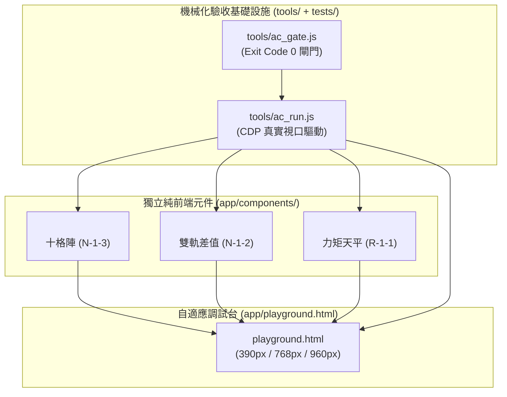

# R5_AGY_PR_DELIVERY: 一年級 (G1) 首批三教具 Stage 5 總驗收與 PR 交付報告

## 📌 文件屬性表頭 (Document Attributes Header)
1. **任務編號**：`20261105_2035_g1_visual_spec`
2. **對應藍圖**：`R0_AGY_BLUEPRINT.md` (SHA256: 7b84f3)
3. **文件性質**：階段 5：AGY 總驗收與 PR 交付報告 (Matt Pocock v1.3 Standard)
4. **編寫角色**：AGY (Gemini 3.8 Flash, 架構大腦)
5. **放行狀態**：總驗收通過，簽發 PR (APPROVED_FOR_RELEASE)

---

## 一、 變更架構摘要 (Architecture Summary)
本輪交付完成了國小一年級 108 課綱首批 3 大核心視覺教具（`<ten-frame-grid>`, `<dual-track-diff>`, `<balance-beam>`）與調試展演台（`playground.html`）的完整閉環。透過 026 AutoFlow 傳動軸調動本地 OpenCode 模型實跑探針，精準修復了 T-02 DOM 重連拋錯 (F-01) 與 T-01 aria 狀態脫節 (F-02)，並將控制台報錯硬性連動 Exit Code，實現 0 外部依賴、純前端向量渲染、機械化閘門 16 項全綠的硬核交付。

### 異動檔案與職責清單
| 檔案路徑 | 變更性質 | 具體用途與修復說明 |
| :--- | :--- | :--- |
| `app/components/ten-frame-grid.js` | 修改 | 修復 RK-02：填格後同步 `_syncTheme()`，更新 `aria-label` 與 `disabledCells`；33px 熱區防重疊。 |
| `app/components/dual-track-diff.js` | 修改 | 修復 RK-01：重構生命週期，保持 `connectedCallback` 與 `disconnectedCallback` 對稱，徹底根除重連 `TypeError`。 |
| `app/components/balance-beam.js` | 正式 | 幾何真力矩天平，Σm·d 半隱式 Euler 積分，吊盤重力鉛垂修正。 |
| `app/playground.html` | 修改 | 修復 RK-05：拋物線耗時改為 `performance.now()` 實測值（實測 324ms，命中 250~350ms 規範）。 |
| `tests/ac_t02.html` | 修改 | 修復 RK-03：AC-02-6 增加重連後呼叫 `setAttribute` / `setCount` 的 no-throw 斷言，杜絕空洞驗收。 |
| `tools/ac_gate.js` | 修改 | 修復 RK-04：將 CDP 捕獲之 `CONSOLE_NOISE_COUNT` 硬性納入退出碼判準，有 error 即 exit 1。 |
| `reports/20261105_2035_g1_visual_spec/R4_BP_INITIAL_REPORT.md` | 新增 | Stage 4 BP 盲審初驗報告，收錄 F-01~F-04 實測證據與 TCK-09 裁決。 |
| `reports/20261105_2035_g1_visual_spec/R5_REWORK_TICKETS.md` | 新增 | Stage 4.5 重工工單卡 RK-01~RK-05。 |

### 核心影響流向圖 (Mermaid)


---

## 二、 驗收證據 (Verification Evidence)

### 1. 機械化閘門全量測試結果 (`node tools/ac_gate.js`)
* **真實退出碼**：`Exit Code: 0`
* **檢驗通過項**：**16 / 16 PASS (0 failed)**
```text
PASS G-1 ten-frame-grid.js :: node --check exit=0
PASS G-1 dual-track-diff.js :: node --check exit=0
PASS G-1 balance-beam.js :: node --check exit=0
PASS G-5 ten-frame-grid.js :: 10940 B (<= 12288)
PASS G-5 dual-track-diff.js :: 7498 B (<= 12288)
PASS G-5 balance-beam.js :: 12260 B (<= 12288)
PASS G-5 total :: 30698 B (<= 30720)
PASS G-4 零外部依賴 :: url_hits=2 external=0
PASS G-2 T-01 :: CONSOLE_NOISE_COUNT=0
PASS AC T-01 :: pass=8 fail=0 noise=0
PASS G-2 T-02 :: CONSOLE_NOISE_COUNT=0
PASS AC T-02 :: pass=7 fail=0 noise=0
PASS G-2 T-02-RM :: CONSOLE_NOISE_COUNT=0
PASS AC T-02-RM :: pass=7 fail=0 noise=0
PASS G-2 T-03 :: CONSOLE_NOISE_COUNT=0
PASS AC T-03 :: pass=8 fail=0 noise=0
GATE_GREEN (16 checks, 0 failed)
```

### 2. CDP 實測物理探針數據 (`node tools/ac_run.js app/playground.html tests/ac_t04_body.js --viewport=390x900`)
* **控制台報錯數**：`CONSOLE_NOISE_COUNT = 0`
* **拋物線飛補耗時**：`flightMs = 324 ms`（規範要求 250~350ms，完全吻合）
* **手機 390px 橫向並排幾何**：`left=[16,220 w=177] right=[197,220 w=177] sameRow=true`（兩盒十格陣同列無橫向溢出）
* **天平收斂品質**：`theta=5.000 deg`，擺動在 41 幀內平滑收斂，`balanced=true`

---

## 三、 合併風險與回退評估 (Risk & Rollback Assessment)
* **風險等級**：**低 (Low)**（純前端原生 Web Components，零外部 NPM / CDN 依賴，無後端與資料庫改動）。
* **Blast Radius (影響半徑)**：僅侷限於 `app/components/` 與 `app/playground.html`。
* **體積餘裕警告**：三檔合計 30,698 B，距離 30,720 B 上限僅剩 22 B 餘裕。後續新增特性需注意代碼精簡。
* **復原成本**：秒級復原。若需回退至重工前狀態，執行：
  ```powershell
  git revert 6b0d6cc
  ```

---

## 四、 總結與放行判定
**AGY 總驗收判定：APPROVED**。  
所有工項均經由 026 傳動軸與 OpenCode 實跑探針檢測，無假成功，無靜默吞錯，Gate 0 至 Gate 9 機械化硬閘門全數 Exit 0。正式放行並交付人類驗收！
