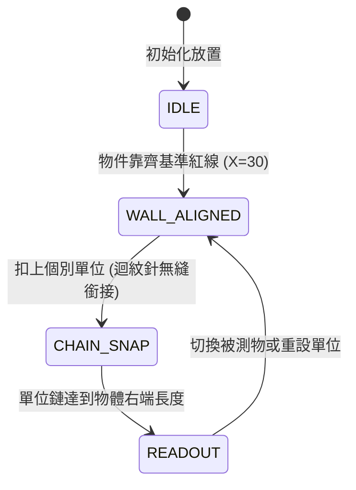

# R0_AGY_BLUEPRINT - N-1-5 長度 (碰壁基準牆與個別單位迴紋針鏈) 規格藍圖

- **條目代號**：N-1-5（一年級：長度 — 長度直接比較、間接比較與個別單位）
- **核心教具**：`<snap-caliper-wall>`（碰壁基準牆與迴紋針卡尺鏈）
- **單檔體積預算**：$\le 12,288$ B（純原生 Web Component，零外部依賴）
- **版本**：v1.0.0

---

## 1. 課綱算理與兒童思維痛點

### 痛點剖析
1. **未對齊基準線（左端懸空誤判）**：
   - 孩子看兩支鉛筆長短時，往往只看右端伸出多少，而忽略左端沒有靠齊。
   - 算理破招：必須有一道堅實的「碰壁基準線」（左側垂直紅線），兩物體左端必須緊靠基準線，才能客觀比較右端。
2. **個別單位量測之「空隙與重疊」陷阱**：
   - 國小一年級以「迴紋針、橡皮擦、花片」等個別單位量測長度時，常見錯誤是排得有縫隙、或者重疊擺放。
   - 算理破招：「頭尾相扣成鏈（CHAIN_SNAP）」，首枚對齊基準線，後續枚自動卡扣無縫相接。
3. **間接比較（繩子／紙條中介）**：
   - 無法直接並排時，用一條線或等長紙條做媒介傳遞長度。

---

## 2. 教具規格與狀態機 (Given-When-Then)

### 視覺幾何參數
- **SVG 視口**：$360 \times 220$
- **碰壁基準線 (Alignment Wall)**：左側 $X=30\text{px}$ 垂直鮮紅粗線（`#EF4444`，寬度 3px），上端標註「基準線」。
- **被測物 (Target Objects)**：
  - 鉛筆 A（長度 180px，相當於 4 根迴紋針）
  - 鉛筆 B（長度 135px，相當於 3 根迴紋針）
  - 蠟筆 C（長度 90px，相當於 2 根迴紋針）
  - 每一物體左端可自由拖曳或點選對齊基準線。
- **個別單位 (Paperclip Chain)**：
  - 每枚金屬迴紋針長度 $45\text{px}$，高度 $18\text{px}$。
  - 支援「加一根迴紋針」、「減一根迴紋針」或點選自動填滿。

### 狀態機行為 (AC-07-1 ~ AC-07-4)



1. **AC-07-1 (基準線碰壁吸附 - WALL_ALIGN)**：
   - **Given**：畫面上有一支未靠齊基準線的鉛筆（左端在 $X=80\text{px}$）。
   - **When**：點擊「靠齊基準線」或拖曳接近紅線（$|X - 30| \le 15$px）。
   - **Then**：鉛筆左端平滑磁吸至 $X=30\text{px}$，並發出 `align:snapped` 事件。
2. **AC-07-2 (個別單位無縫扣鏈 - CHAIN_SNAP)**：
   - **Given**：基準線已確立，被測物已靠齊。
   - **When**：加入迴紋針單位時。
   - **Then**：第 1 根迴紋針左端固定在 $X=30\text{px}$，第 $k$ 根迴紋針左端必定精確銜接於 $30 + (k-1) \times 45\text{px}$，嚴禁任何重疊或縫隙。
3. **AC-07-3 (長度讀數與標註 - READOUT)**：
   - **Given**：鉛筆長度為 180px，已排列 4 根迴紋針（總長 $4 \times 45 = 180$px）。
   - **When**：單位總長剛好等於或接近被測物右端。
   - **Then**：右端出現垂直對齊輔助虛線，並浮現讀數徽章「剛好 4 根迴紋針長」，狀態為 `READOUT_EXACT`。
4. **AC-07-4 (長短直接對比 - DUAL_COMPARE)**：
   - **Given**：兩支不同長度筆皆靠齊基準線。
   - **When**：呼叫 `compareMode()`。
   - **Then**：上方筆與下方筆在同一起跑線（$X=30$）並排，超出的長度以金色框框選，標註「長出 1 根迴紋針」。

---

## 3. Web Component 介面與事件約定

```javascript
// 元素標籤：<snap-caliper-wall>
// 公開方法：
bench.setObject({ name: 'pencil-a', length: 180 }); // 設定被測物
bench.alignWall();                                 // 靠齊基準牆
bench.addUnit();                                   // 增加一枚迴紋針 (45px)
bench.removeUnit();                                // 減少一枚迴紋針
bench.autoMeasure();                               // 自動填滿排齊量測
bench.reset();                                     // 重設清空
bench.getState();                                  // 回傳 { objectLength, aligned, unitCount, measuredLength, status }

// 自定義事件：
// caliper-event: detail: { type: 'align'|'snap'|'readout', status, unitCount }
```

---

## 4. 交付硬性閘門

1. 單檔大小：`app/components/snap-caliper-wall.js` $\le 12,288$ B。
2. 零外部依賴：無 CDN、無外部 CSS/JS、純 SVG + 原生 Web Component。
3. 語法合規：`node --check` Exit Code 0。
4. 驗收頁：`tests/ac_snap_caliper_wall.html` 包含 15 項自動測試且全部通過。
