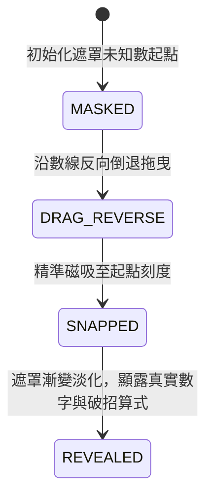

# R0_AGY_BLUEPRINT - N-1-4 解題 (毛玻璃遮罩數線反推儀) 規格藍圖

- **條目代號**：N-1-4（一年級：解題 — 加減應用、未知數在不同位置、數線逆運算反推）
- **核心教具**：`<glass-number-line>`（毛玻璃遮罩數線反推儀）
- **單檔體積預算**：$\le 12,288$ B（純原生 Web Component，零外部依賴）
- **版本**：v1.0.0

---

## 1. 課綱算理與兒童思維痛點

### 痛點剖析
1. **「見加就加、見減就減」的直覺陷阱**：
   - 題目：$(\quad) + 5 = 12$。一年級孩子看到題目中有數字 5 和 12，且符號是加號，常會反射性把 $5 + 12 = 17$ 當成答案。
   - 算理破招：數線視覺化！已知「最後到達 12」，且「往前走了 5 格」，要求「從哪裡出發」，必須從 12「往回倒退 5 格」！逆算為 $12 - 5 = 7$。
2. **減法未知數位置混淆**：
   - 題目 A（被減數未知）：$(\quad) - 4 = 8$ ➔ 原本有多少？逆算為 $8 + 4 = 12$。
   - 題目 B（減數未知）：$15 - (\quad) = 9$ ➔ 拿走了多少？從 15 走到 9 差了幾格？算式為 $15 - 9 = 6$。

---

## 2. 教具規格與狀態機 (Given-When-Then)

### 視覺幾何參數
- **SVG 視口**：$360 \times 220$
- **數線主軸 (Number Line)**：水平直線，刻度 0 到 20。
  - $X=30$ 為刻度 0，$X=330$ 為刻度 20。每 1 格寬度 $\text{step} = (330 - 30) / 20 = 15\text{px}$。
  - 刻度 $0, 5, 10, 15, 20$ 為加粗主刻度，下方顯示數字標籤。
- **毛玻璃遮罩盒 (Frosted Mask Box)**：
  - 寬度 24px，高度 30px，圓角 4px，帶有 `?` 標籤。
  - 支援磁吸到數線刻度（Snap to ticks，步進 15px）。
- **跳躍箭頭 (Jump Arrow)**：
  - 弧形拋物線箭頭，標註跨越步數（如 `+5` 或 `-4`）。

### 狀態機行為 (AC-08-1 ~ AC-08-4)



1. **AC-08-1 (數線步進磁吸 - SNAP_TICK)**：
   - **Given**：數線刻度 0~20，step=15px。
   - **When**：拖曳或呼叫 `moveToTick(k)`。
   - **Then**：遮罩盒中心座標精確吸附在 $30 + k \times 15\text{px}$，發出 `numline:snap` 事件。
2. **AC-08-2 (未知起點逆算 - REVERSE_WALK)**：
   - **Given**：情境 $(\quad) + 5 = 12$。
   - **When**：呼叫 `stepReverse()` 或點擊「倒退反推」。
   - **Then**：自刻度 12 向左回溯 5 格拋物線，抵達刻度 7，狀態轉為 `REVERSE_ACTIVE`。
3. **AC-08-3 (遮罩揭曉破招 - REVEAL_ANSWER)**：
   - **Given**：已反向抵達正確起點刻度 7。
   - **When**：呼叫 `reveal()`。
   - **Then**：遮罩盒子漸變透明，金色顯露數字 `7`，數線上方浮出破招算式 `12 - 5 = 7`，狀態為 `REVEALED`。
4. **AC-08-4 (減法未知數切換 - SUB_UNKNOWN)**：
   - **Given**：情境 $15 - (\quad) = 9$。
   - **When**：呼叫 `setScenario('sub_unknown', { start: 15, end: 9 })`。
   - **Then**：數線標記 15 與 9 兩點，兩點之間的間距高亮框選，顯示「跨越 6 格」，揭曉 $(\quad) = 6$。

---

## 3. Web Component 介面約定

```javascript
// 元素標籤：<glass-number-line>
// 公開方法：
bench.setEquation({ mode: 'add_start', start: 7, jump: 5, end: 12 });
bench.stepReverse();     // 執行反向回溯動畫
bench.reveal();          // 揭曉答案
bench.reset();           // 重設清空
bench.getState();        // 回傳 { mode, start, jump, end, currentTick, status, revealed }

// 自定義事件：
// numline-event: detail: { type, tick, status, equation }
```

---

## 4. 交付硬性閘門

1. 單檔大小：`app/components/glass-number-line.js` $\le 12,288$ B。
2. 零外部依賴：無 CDN、無外部 CSS/JS、純 SVG + 原生 Web Component。
3. 語法合規：`node --check` Exit Code 0。
4. 驗收頁：`tests/ac_glass_number_line.html` 包含 15 項自動測試且全部通過。
