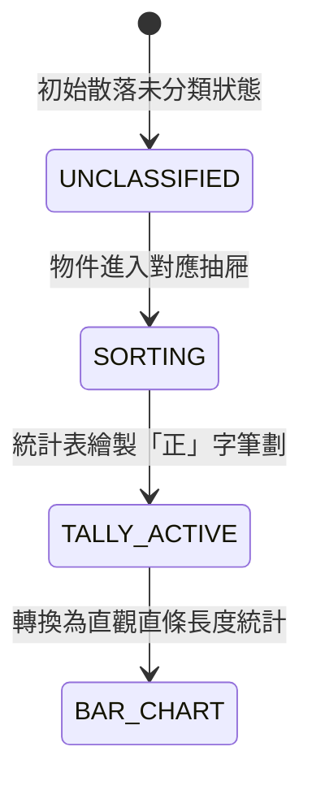

# R0_AGY_BLUEPRINT - D-1-1 統計與分類 (分類抽屜與正字劃記計數台) 規格藍圖

- **條目代號**：D-1-1（一年級：資料分類與呈現 — 單一特徵分類、正字劃記、計數統計表格、一維長條圖呈現）
- **核心教具**：`<data-sorter-bench>`（分類抽屜與正字劃記計數台）
- **單檔體積預算**：$\le 12,288$ B（純原生 Web Component，零外部依賴）
- **版本**：v1.0.0

---

## 1. 課綱算理與兒童思維痛點

### 痛點剖析
1. **雜亂點數容易「重數」或「漏數」**：
   - 一年級孩子面對散落一桌的物品，常常用手指東點西點，數到後面忘記哪一個數過、哪一個沒數過。
   - 算理破招：**分類入庫（分類抽屜）**！數一個、裝進去一個，原處立即消失或標記，做到「不重不漏」。
2. **正字劃記的五進位累積概念**：
   - 傳統阿拉伯數字計數無法反映逐一記錄的過程；「正」字恰好 5 劃（一橫、一豎、一橫、一豎、一橫），每滿 5 劃形成一個完整的「正」字。
   - 算理破招：5 個 5 個一數（5, 10, 15...），快速算出總數。
3. **從表格到長條圖（高矮直觀比較）**：
   - 孩子看數字可能無法第一時間感受多寡，但轉換為垂直堆疊長條時，一眼就能看出「誰最高（最多）」、「誰最矮（最少）」。

---

## 2. 教具規格與狀態機 (Given-When-Then)

### 視覺幾何參數
- **SVG 視口**：$360 \times 220$
- **頂部待分類散落區**：散落不同物品（如：蘋果、香蕉、橘子；或圓形、三角形、正方形），各 2~6 個。
- **分類抽屜 (Category Drawers)**：
  - 3 個分類槽，附帶顏色與圖示標籤。
  - 支援點擊「分類下一個」或「自動全分類（autoSort）」。
- **正字劃記區 (Tally Board)**：
  - 5 劃分解：筆劃 1:橫, 筆劃 2:豎, 筆劃 3:短橫, 筆劃 4:短豎, 筆劃 5:底長橫。
  - 當計數增加時，依序繪製對應筆劃。
- **長條統計長條 (Bar Chart Mode)**：
  - 點擊「切換直條圖」時，正字動畫立體直立展開為垂直長條柱。

### 狀態機行為 (AC-09-1 ~ AC-09-4)



1. **AC-09-1 (分類不重不漏 - ITEM_SORT)**：
   - **Given**：散落區有待分類物件。
   - **When**：呼叫 `sortItem(itemType)` 或 `autoSort()`。
   - **Then**：散落區該物件飛入對應抽屜，待分類計數 $-1$，抽屜計數 $+1$。
2. **AC-09-2 (正字劃記筆劃精確性 - TALLY_STROKE)**：
   - **Given**：某類別計數為 $k$。
   - **When**：計數自 $0$ 增加至 $7$。
   - **Then**：對應正字劃記完整顯示 1 個「正」字（5 劃）加上 1 個「下」（2 劃），共 7 劃。
3. **AC-09-3 (五的倍數累加讀數 - FIVE_COUNT)**：
   - **Given**：所有物件已全部分類完畢。
   - **When**：呼叫 `getSummary()`。
   - **Then**：回傳各類數量、最大值類別、最小值類別與總計數。
4. **AC-09-4 (長條統計視圖切換 - BAR_CONVERT)**：
   - **Given**：已完成計數。
   - **When**：呼叫 `toggleBarView(true)`。
   - **Then**：視圖切換為直條統計柱，高度比例 $\text{height} = \text{count} \times 12\text{px}$，頂部標示各類數值。

---

## 3. Web Component 介面約定

```javascript
// 元素標籤：<data-sorter-bench>
// 公開方法：
bench.setData({ categories: ['蘋果', '香蕉', '橘子'], counts: [5, 3, 4] });
bench.autoSort();            // 自動完成分類動畫
bench.toggleBarView(bool);   // 切換正字劃記 vs 直條統計圖
bench.reset();               // 重設清空
bench.getState();            // 回傳 { sorted, currentView: 'tally'|'bar', totals: {...}, most, least }

// 自定義事件：
// sorter-event: detail: { type: 'sort'|'tally'|'view', state }
```

---

## 4. 交付硬性閘門

1. 單檔大小：`app/components/data-sorter-bench.js` $\le 12,288$ B。
2. 零外部依賴：無 CDN、無外部 CSS/JS、純 SVG + 原生 Web Component。
3. 語法合規：`node --check` Exit Code 0。
4. 驗收頁：`tests/ac_data_sorter_bench.html` 包含 15 項自動測試且全部通過。
