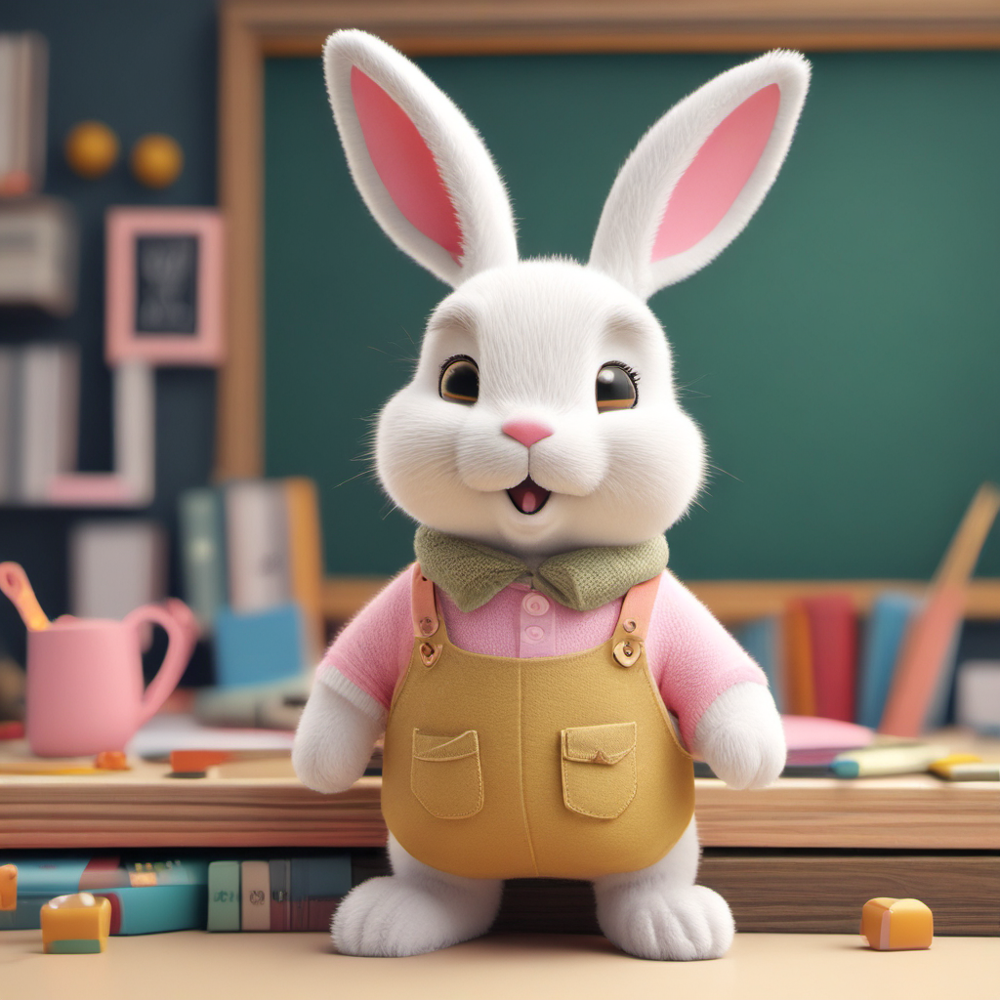
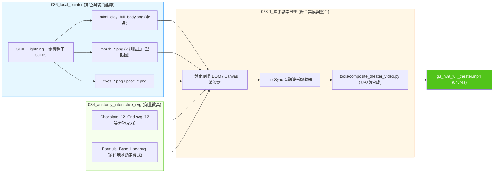

# 🎬 G3-N-3-9 一體化教室情境劇院：阿德曼定格偶動畫全流程規格藍圖

<!-- ARCHITECT: Channel 3 (035 Gemini Pool Multi-Modal Brain) -->
<!-- STATUS: PLAN_SUBMITTED_FOR_REVIEW -->
<!-- TARGET_PROJECTS: 036_local_painter, 034_anatomy_interactive_svg, 028-1_國小數學APP -->
<!-- EXEC_TARGET: Channel 1 (OpenCode CLI with Heartbeat Monitor) -->
<!-- MONITOR_ONLY: AGY (Antigravity strictly locked as monitor) -->

> **課綱單元**：108 課綱 `G3-N-3-9`（簡單同分母分數加法：12 塊平分巧克力，$\frac{3}{12} + \frac{7}{12} = \frac{10}{12}$）  
> **主角定義**：白兔米米老師（Mimi）🐰 —— 3D 黏土定格偶（Aardman Claymation Puppet）  
> **設計模式**：**阿德曼實體定格偶動畫（Aardman Claymation Stop-Motion Rig）**  
> **空間哲學**：**一體化溫馨教室（Unified Classroom Theater）** —— 徹底廢除 48:52 左右雙螢幕分割，全身立體米米老師與向量黑板融合在同一物理景深空間，零割裂感。

---

## 🏛️ 一、 專案背景與阿德曼定格偶動畫架構定義

### 1. 核心風格與美學規範
- **阿德曼定格質感（Claymation Style）**：模擬真實手工捏製黏土的物理質地，帶有自然細微的捏痕、手作溫潤光影與次表面散射（SSS），徹底根除 AI 視頻生成常有的果凍液化拉扯感。
- **定格節奏感（Stop-Motion Timing）**：
  - 角色待機與動作採用 **12fps 抽二（On Twos）** 的經典定格幀率，帶有手工微晃動與物理慣性。
  - 語音對嘴採用 **替換式黏土口型（Replacement Mouth Animation）**，由音訊波形精準切換標準黏土嘴形貼圖。

### 2. 空間哲學：一體化教學空間（拒絕 48:52 硬切線）
- 摒棄過去「左邊放一個視訊方塊、右邊放一塊黑板」的生硬切屏。
- 建立具備 3D 景深與真實透視的單一攝影棚舞台：
  - **背景層**：溫馨暖色調木質護牆教室與掛牆墨綠色黑板。
  - **中景層**：木質講台與粉筆槽，黑板上為 `034` 向量高對比動態算理教具。
  - **前景層**：**完整全身**的小白兔米米立體站立於講台側前方，與黑板保持約 35% 橫向空間間距，手部可自然指向黑板算式，幾何嚴格保證 **零穿模、零遮擋**。

---

## 📐 二、 一體化教室空間佈局與全身幾何規格

在 16:9（1280×720）至手機端（390×844）自適應舞台中，座標與幾何嚴格規範如下：

```text
+-----------------------------------------------------------------------------------+
|  [ 天花板暖色柔光照明 / 教室背景牆 Z: -100 ]                                       |
|                                                                                   |
|                +--------------------------------------------------+               |
|                |  034 向量演武場：墨綠色磨砂黑板 (Z: 0)            |               |
|                |  X: 38% ~ 96%, Y: 12% ~ 82%                      |               |
|                |                                                  |               |
|  [米米全身偶]   |  12 塊平分巧克力 | 1/12 單位卡 | 算式與金色地基框   |               |
|  (Z: +50)      +--------------------------------------------------+               |
|  X: 4% ~ 34%                                                                      |
|  Y: 18% ~ 92%                                                                     |
|  (全身體長佔比 74%)                                                               |
|  [木質講台邊緣 Z: +20]                                                             |
+-----------------------------------------------------------------------------------+
|  [ 底部高對比字幕條 / 曉臻語音同步字幕 (Z: +100) ]                                 |
+-----------------------------------------------------------------------------------+
```

### 幾何硬性約束（CDP 自動化測試守門條件）：
1. **米米全身可見性**：兔耳頂端 $Y \ge 8\%$、腳底 $Y \le 94\%$，完整展現頭部、藍色圍裙軀幹與腳步站姿，絕不可裁切成半身或塞入小框。
2. **空間零相交遮擋**：米米的最右側邊界 `mimi.right` 嚴格小於等於黑板主要數學元件的最左側邊界 `math.left - 24px`，保證米米指向黑板時，手掌邊緣與數學算式邊界完美互不干擾。

---

## 🐰 三、 小白兔米米定格偶資產規格表與實體圖面（036 落點）

### 🖼️ 核心定裝與全身規格實體圖（三張基準圖）

> 本藍圖實體鎖定以下 3 張核心基準圖面，作為工兵施工與通道三視覺驗收的單一真理源（SSOT）：

#### 【圖一：036 原始金牌種子全身定裝照（Golden Seed 30105，全身站姿基準）】

- **實體路徑**：[`docs/tasks/assets/mimi/sample_mimi_seed30105.png`](file:///d:/ANTIGRAVITY/028-1_國小數學APP/docs/tasks/assets/mimi/sample_mimi_seed30105.png)（來源：`036_local_painter/output/sample_mimi_seed30105.png`）
- **關鍵規格**：$1024 \times 1024$ 高清大圖。包含完整的站立身形、雙腳站姿、木質講台與教室墨綠黑板背景。此圖為米米全身比例、骨架姿態、吊帶圍裙鈕扣與光影質感的金牌基準。

#### 【圖二：036 專案材質庫正視態高畫質大圖（1024×1024 錨定母本）】

- **實體路徑**：[`docs/tasks/assets/mimi/mimi_front_1024.png`](file:///d:/ANTIGRAVITY/028-1_國小數學APP/docs/tasks/assets/mimi/mimi_front_1024.png)（來源：`036_local_painter/theater/assets_hosts/g3_mimi/textures/mimi_front_1024.png`）
- **關鍵規格**：正式錨定材質庫檔案，用於提取臉部特徵、五官對稱性與標準色票（#2ECC71 領巾、吊帶圍裙）。

#### 【圖三：028-1 劇院現有透明去背圖（1024×591 透明 PNG，去背參考）】

- **實體路徑**：[`docs/tasks/assets/mimi/mimi_transparent_1024.png`](file:///d:/ANTIGRAVITY/028-1_國小數學APP/docs/tasks/assets/mimi/mimi_transparent_1024.png)（來源：`028-1_國小數學APP/app/scenes/g3_n39_theater/assets_hosts/g3_mimi/textures/mimi_transparent_1024.png`）
- **關鍵規格與待辦**：目前前端劇院舞台所使用的去背圖。**注意**：現存此檔裁切到了大腿，後續施工必須以【圖一】為底稿，補齊下肢與雙腳完整站姿的「**100% 全身透明去背圖**」，確保一體化教室舞台中米米能立體完整全身出鏡！

---

### 📋 定格偶資產規格表
所有資產均由 `036_local_painter` 生成並維護，存放於 `036_local_painter/theater/assets/mimi_clay/`：

| 資產類別 | 規格檔名 | 尺寸與格式 | 物理描述與特徵 |
| :--- | :--- | :--- | :--- |
| **全身基底偶** | `mimi_clay_full_body.png` | 1024×1536 PNG 透明去背 | 經典金牌種子（30105），藍色圍裙配木質鈕扣、毛絨黏土白兔、兩隻直立長耳（內粉外白）、琥珀色大眼。 |
| **替換式口型庫** | `mouth_rest.png`<br>`mouth_a.png`<br>`mouth_e.png`<br>`mouth_i.png`<br>`mouth_o.png`<br>`mouth_u.png`<br>`mouth_surprise.png` | 256×256 PNG 透明去背 (共 7 組) | 純手工黏土捏製質感三瓣嘴，包含閉合待機、發音開口（A/O/U）與驚喜圓口，精準對齊米米面部座標 `(x: 512, y: 580)`。 |
| **眼部表情組** | `eyes_normal.png`<br>`eyes_blink.png`<br>`eyes_happy.png`<br>`eyes_think.png` | 256×256 PNG 透明去背 | 豆豆眼黏土微高光：正常直視、自然微眨眼（每 3~4 秒觸發 2 幀）、彎月開懷笑、斜上 15 度思考。 |
| **肢體姿態組** | `pose_idle.png`<br>`pose_point_board.png`<br>`pose_hold_chocolate.png`<br>`pose_cheer.png` | 1024×1536 PNG 透明去背 | 1. 雙手垂放微握待機<br>2. 右手平舉指向右側黑板算式<br>3. 雙手微捧展示一整條巧克力<br>4. 雙手高舉開心歡呼點頭。 |
| **定格微抖動** | `clay_jitter_profile.json` | 矩陣配置檔 | 每秒 12fps 產生 $\pm 0.5\text{px}$ 隨機微平移與 $0.998 \sim 1.002$ 縮放，重現真實定格拍攝的細微手作晃動感。 |

---

## 📜 四、 四幕分鏡腳本與音畫卡點對齊表（100% 沿用定稿文案）

> **總時長**：84.74 秒  
> **語音**：微軟 Edge-TTS 曉臻自然女聲（`zh-TW-HsiaoChenNeural`）

### 幕次詳情與卡點契約：

```carousel
### 🎬 Act 1：情境導入 (0.00s ~ 22.35s，共 22.35s)
<!-- slide -->
- **【台詞文案】**：「嗨！小朋友，我是米米！你看，我這裡有一條超好吃的巧克力！我們把它平分成 12 塊。我拿了其中的 3 塊，好朋友拿了 7 塊！嘿嘿，你有沒有發現，我們兩個人合起來，到底是拿了這整條巧克力的幾分之幾呢？」
- **【米米定格動作】**：
  - 0.0s ~ 4.0s：`pose_idle`，頭部微傾，揮手微笑，口型切換說話。
  - 4.0s ~ 10.0s：切換 `pose_hold_chocolate`，雙手捧出巧克力道具。
  - 10.0s ~ 22.35s：轉身切換 `pose_point_board`，手平穩指向右側黑板。
- **【黑板 034 向量動態】**：
  - 0.0s ~ 5.0s：黑板浮現完整 1 條長方形深棕色巧克力。
  - 5.0s ~ 12.0s：白光虛線掃過，均勻切分成 **12 塊等分格**。
  - 12.0s ~ 22.35s：左邊 3 塊亮起淺藍光（米米拿），緊接著 7 塊亮起橙黃光（朋友拿）。

<!-- slide -->
### 🎬 Act 2：單位分數 (22.35s ~ 42.57s，共 20.22s)
- **【台詞文案】**：「我們來數數看喔！3 塊加上 7 塊，1、2、3……到 10！總共是 10 塊！但是，我們要怎麼用『分數』記下來呢？別忘了，整條巧克力原本平分成了 12 塊，所以每一小塊，都是『十二分之一』條喔！」
- **【米米定格動作】**：
  - 22.35s ~ 30.0s：保持 `pose_point_board`，隨計數 1~10 手指微微輕點，眼神專注看黑板。
  - 30.0s ~ 36.0s：切換 `eyes_think`，右手托腮做出動腦思考姿態。
  - 36.0s ~ 42.57s：眼睛一亮（`eyes_happy`），手再次有力指向黑板單位卡片。
- **【黑板 034 向量動態】**：
  - 22.35s ~ 30.0s：已拿走的 10 塊巧克力上方依序跳出 1~10 計數氣泡數字。
  - 30.0s ~ 36.0s：中央浮現大問號「？」。
  - 36.0s ~ 42.57s：單獨抽出一小塊巧克力特寫，下方彈出粉筆卡片：$\frac{1}{12}$ 條，標註「每一塊都是 $\frac{1}{12}$」。

<!-- slide -->
### 🎬 Act 3：核心算理 (42.57s ~ 67.74s，共 25.17s)
- **【台詞文案】**：「所以呀，米米的 3 塊就是十二分之三條，好朋友的 7 塊就是十二分之七條。合起來的 10 塊，就是 12 塊裡面的 10 塊，也就是——『十二分之十』條！小朋友注意看：分母 12 代表『一整條平分幾塊』，它就像房子的地基，是絕對不會變的！我們只要把上面的分子加起來就好囉！」
- **【米米定格動作】**：
  - 42.57s ~ 52.0s：`pose_point_board` 指向橫式算式。
  - 52.0s ~ 62.0s：雙手掌心朝下平壓，模擬強調「房子地基穩定不動」的沉穩姿態。
  - 62.0s ~ 67.74s：右手向上輕推，強調「只有分子相加」。
- **【黑板 034 向量動態】**：
  - 42.57s ~ 50.0s：黑板浮現大字粉筆算式：$\frac{3}{12} + \frac{7}{12} = \frac{10}{12}$。
  - 50.0s ~ 60.0s：分母的兩個 `12` 與結果的 `12` 同步閃耀金色光芒，底座浮現「金色磚石地基框」，文字高亮「分母不動」。
  - 60.0s ~ 67.74s：分子的 `3` 與 `7` 向上飄起合流，化為粒子落入結果的 `10`。

<!-- slide -->
### 🎬 Act 4：總結互動 (67.74s ~ 84.74s，共 17.00s)
- **【台詞文案】**：「太棒了！答案就是十二分之十條！記住米米的祕笈：『分母看平分幾份，分子看拿走幾份』！你已經把分數相加的祕密完全搞懂囉！換你動手挑戰看看吧，掰掰！」
- **【米米定格動作】**：
  - 67.74s ~ 76.0s：切換 `pose_cheer`，雙手高舉開心歡呼，頭頂長耳輕快晃動。
  - 76.0s ~ 84.74s：熱情揮手告別（Bye-bye 定格動作），笑容燦爛。
- **【黑板 034 向量動態】**：
  - 67.74s ~ 76.0s：算式平滑向上推移，黑板中央彈出大號金色太陽獎章，緞帶飄揚。
  - 76.0s ~ 84.74s：浮現閃亮按鈕「進入挑戰 ▶」，伴隨粒子星光提示學生開始作答。
```

---

## 🔄 五、 跨專案協同管線（Multi-Project Pipeline）



---

## 🛡️ 六、 Plan-PR 分步施工計畫、15s 心跳監控與驗收契約

### 🚨 執行者與監控者權責鐵律
- **架構藍圖規劃**：**通道三（035 Gemini 金鑰池）** 唯一真理。
- **具體工程施工**：**通道一（OpenCode CLI）**，以本機帶手腳工兵施工。
- **即時心跳監控**：**AGY 嚴格作為外部監控者（MONITOR ONLY）**，嚴禁親自編寫業務代碼。
- **15s 假死熔斷保護**：工兵執行每道指令超過 15 秒無心跳輸出，自動觸發熔斷並報警。
- **雙簽硬門禁驗收**：每一階段完工產物，必須提交**通道三多模態眼睛（`verify_*_channel3.py`）** 或 **通道一有眼模型** 做實體圖檔/影格檢核，產出真實 Exit Code 0，嚴禁任何純文本口頭保證！

---

### 門禁排程（Gate 0 ~ Gate Total）

| 階段門禁 | 施工目標 | 產出物 (Artifacts) | 檢驗方式與工具 | 通過標準 (Exit Code 0) |
| :--- | :--- | :--- | :--- | :--- |
| **Gate 0: 資產到位驗真** | 檢查 036 小白兔全身透明偶與口型貼圖、034 向量巧克力教具檔案完整性。 | `reports/gate0_assets_manifest.json` | 執行檢查腳本 `tools/verify_gate0_assets.py` | 全身偶 PNG 存在且去背乾淨、7 組口型尺寸相符、音訊 84.74s 吻合。 |
| **Gate 1: 一體化舞台空間佈局** | 更新 `app/scenes/g3_n39_theater/index.html`，排布一體化空間與全身米米。 | 實體截圖：`reports/screenshots/stage_layout_check.png` | 通道三多模態審查：`tools/verify_stage_layout_channel3.py` | 1. 零 48:52 硬切線<br>2. 米米全身無裁切<br>3. 米米與黑板水平零相交遮擋。 |
| **Gate 2: 定格微動與口型同步** | 串接音訊波形，實時切換黏土口型，疊加 12fps 手工微抖動。 | 逐幕影格序列與 `Act1_Act2_lipsync_test.mp4` | 通道三抽幀檢查（每幕抽取第 10, 25, 50 幀） | 1. 口型隨音訊真實開合<br>2. 黏土質感無拉扯液化<br>3. 眨眼自然。 |
| **Gate 3: 四幕算理與教具連貫** | 完成 Act 1~4 全四幕教具動態卡點（12等分巧克力、金色地基鎖定、獎章彈出）。 | 四幕實體錄影：`act1_demo.mp4` ~ `act4_demo.mp4` | 執行 CDP 測量：`tests/verify_g3_n39_theater_cdp.js` | 1. 視口高度 $\le 420\text{px}$<br>2. 算式與語音 100% 同步<br>3. 控制台 0 報錯。 |
| **Gate Total: 全片壓製與最終防偽** | 合成完整 84.74s 教學長片，徹底消滅死圖代碼。 | 最終影片：`app/scenes/g3_n39_theater/video/g3_n39_full_theater.mp4` | 執行防偽審查：`tools/verify_full_theater_video_channel3.py` | 1. 影格間像素差異正常，絕非死圖幻燈片<br>2. 音畫長度精確吻合 84.74s<br>3. 使用者親自點擊驗收。 |

---

**藍圖批准鋼印：**  
Google Account Key Pool 通道三（035 金鑰池）大腦架構師  
*實事求是、言行一致、零假成功、阿德曼定格模式確立。*
